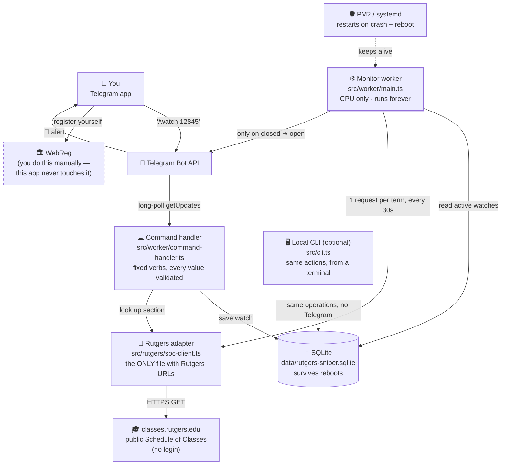

# Rutgers Course Sniper

Get a **Telegram message the instant a closed Rutgers section opens.**

You send your Telegram bot `/watch 12845`, and a small background program checks the Rutgers
Schedule of Classes every 30 seconds. The moment that section flips from closed to open, you get an
alert.

Everything happens in one Telegram chat with one dedicated bot. There is no AI agent in the loop:
the bot understands a fixed list of slash commands, and the monitor is a plain polling loop.

> ### ⚠️ This tool notifies you. It does **not** register you.
>
> When the alert arrives, **you** open WebReg and register yourself. This project never logs into
> WebReg, never automates registration, and never asks for your NetID password, RUID, PAC, or Duo
> code. It only reads the same public course listings anyone can see at
> [classes.rutgers.edu](https://classes.rutgers.edu) without logging in.
>
> **Never give your Rutgers password to any sniping tool, including this one.** It does not need it.

---

## Table of contents

1. [How the pieces fit together](#1-how-the-pieces-fit-together)
2. [Talking to the bot](#2-talking-to-the-bot)
3. [What the TypeScript worker does](#3-what-the-typescript-worker-does)
4. [Why no GPU is involved](#4-why-no-gpu-is-involved)
5. [Installing](#5-installing)
6. [Creating your Telegram bot](#6-creating-your-telegram-bot)
7. [Adding a watch](#7-adding-a-watch)
8. [Listing and removing watches](#8-listing-and-removing-watches)
9. [Status reports and the "did you get in?" question](#9-status-reports-and-the-did-you-get-in-question)
10. [Running the tests](#10-running-the-tests)
11. [Keeping the worker running](#11-keeping-the-worker-running)
12. [Troubleshooting](#12-troubleshooting)
13. [How Rutgers data is actually read](#13-how-rutgers-data-is-actually-read)
14. [Limitations](#14-limitations)

---

## 1. How the pieces fit together



The command handler and the monitor are **two loops inside one process** (`src/worker/main.ts`).
They share a single SQLite connection, which is exactly why they are one process and not two:
`better-sqlite3` is synchronous, so two loops on one connection cannot interleave a write.

The important idea: **nothing here is intelligent.** A command is a fixed verb with validated
arguments, and a poll is one HTTP request plus a set lookup. No model runs anywhere in this system.

---

## 2. Talking to the bot

Set `REPLY_LISTENER_ENABLED=true` and the worker long-polls its own bot's inbox, so you manage
everything from the same Telegram chat the alerts arrive in. No terminal required.

| Command | Does |
|---|---|
| `/watch 12845` | watch a section by index |
| `/watch 01:640:135` | list a course's sections and pick — never watches all of them |
| `/stop 12845`, `/stop all` | stop watching |
| `/cancel 12845` | same as `/stop` — an alias, since "cancel the snipe" is what comes to mind |
| `/list` | your watches |
| `/status` | worker health plus a live open/closed check |
| `/check 12845` | look something up without watching it |
| `/pending` | what is awaiting a "did you get in?" answer |
| `/help` | all of the above |

Plus plain **yes** / **no** to answer the bot's "did you get in?" question (see
[section 9](#9-status-reports-and-the-did-you-get-in-question)).

Add a term, year or campus to `/watch`, `/stop` or `/check`, in any order —
`/watch 12845 spring 2027 NK`. Omit them and your `.env` defaults apply. A four-digit number is
read as a year and a five-digit one as an index, so the two can never be confused.

Register the menu with Telegram once, so the commands autocomplete:

```bash
curl -s -X POST "https://api.telegram.org/bot$TELEGRAM_BOT_TOKEN/setMyCommands" \
  -H 'content-type: application/json' \
  -d '{"commands":[{"command":"help","description":"Show all commands"}]}'
```

### Why this is safe to leave running

The bot is deliberately not clever, and that is the entire security model:

- **A fixed list of verbs.** `parse-command.ts` matches against an allowlist. Unknown verbs are
  rejected outright rather than guessed at. Your message text never reaches a shell.
- **Every value is validated** before it touches the database or the network — index numbers must be
  exactly five digits, chat ids must be integers, and so on.
- **Commands act only on the sender's own watches.** `/stop all` from one chat cannot touch
  another's.
- **`REPLY_ALLOWED_CHAT_IDS` restricts who may talk to it at all.** Left empty, any chat that already
  has an active watch may — which is self-limiting, since a chat with no watches has nothing to act
  on.
- **There is no LLM anywhere in this path.** Nothing interprets, infers, or improvises.

So the worst a stranger who finds the bot can do is be ignored, and the worst an allowed user can do
is manage their own watch list. Neither can touch the machine it runs on.

This is why the sniper uses **its own dedicated bot** rather than sharing one with a general-purpose
AI agent. An agent with code execution means anyone who can message it can reach your machine; this
handler gives them seven verbs scoped to their own data, and no more.

---

## 3. What the TypeScript worker does

The worker (`src/worker/main.ts`) is a plain program that loops forever:

1. **Read** the active watches out of SQLite.
2. **Group** them by term. All your Fall 2026 New Brunswick watches go in one bucket.
3. **Ask Rutgers once per bucket** for the list of every open section that term.
4. **Compare** each watch to that list.
5. **Alert** only when a section changed from closed to open.
6. **Sleep** ~30 seconds (plus a little randomness) and repeat — or longer, if Rutgers has been
   failing (see below).

Two design decisions worth understanding:

**One request, not one per course.** Rutgers publishes a single endpoint listing *every* open index
number for a term (about 12,000 of them, ~95 KB). So whether you watch 1 section or 100, each cycle
is **one** HTTP request. Checking a watch is then just "is this index in the list?" — a hash-set
lookup that takes microseconds.

**Transitions, not states.** The worker remembers the last status it saw. It alerts on the *change*
from closed to open. A section that stays open does not re-alert every 30 seconds. If a section
closes and later opens again, you get a fresh alert.

**It slows down when Rutgers is struggling.** Retries inside a single request cover a blip. A
sustained outage is different: the interval itself doubles per failed cycle — 30s, 60, 120, 240 —
up to `MAX_POLL_INTERVAL_SECONDS` (default 10 minutes), then snaps straight back to normal on the
first success. Meeting a 429 storm with undiminished traffic is both rude and the slowest way to
stop being rate-limited.

It also recovers from network errors without crashing, logs failures as structured JSON, shuts down
cleanly on Ctrl+C (SIGINT) or SIGTERM, and sends you one warning if Rutgers has been unreachable for
15 minutes straight.

---

## 4. Why no GPU is involved

Running a **language model** is genuinely heavy computation — billions of matrix multiplications to
generate a single reply.

Checking whether a course is open is not that. One poll is:

- one HTTPS request, and
- a few hash-table lookups.

The CPU finishes that in well under a millisecond, and almost all of the elapsed time is spent
*waiting for the network*, which no processor can speed up. Running a language model to ask "is
12845 in this list?" would be thousands of times slower and more expensive than a single line of
code that just checks.

The same goes for the command side: `/watch 12845` is parsed by a string match against a list of
seven verbs, not by a model deciding what you meant.

So **nothing in this project touches a GPU, ever.** The whole thing sits on a Mac mini using almost
no power, leaving any model server you run entirely free.

---

## 5. Installing

You need **Node.js 20 or newer**. Check with `node --version`.

```bash
cd ~/code/ruttycoursesniper
npm install
cp .env.example .env
```

Now open `.env` and fill it in (see the next two sections for the Telegram values):

```bash
TELEGRAM_BOT_TOKEN=123456789:AAH...        # from @BotFather
DEFAULT_TELEGRAM_CHAT_ID=123456789         # from @userinfobot
RUTGERS_CAMPUS=NB
RUTGERS_YEAR=2026
RUTGERS_TERM=fall
POLL_INTERVAL_SECONDS=30
DATABASE_PATH=./data/rutgers-sniper.sqlite
LOG_LEVEL=info
```

`.env` is git-ignored — your token will not be committed.

Verify everything works without sending any message or saving anything:

```bash
npm run cli -- check 12845
```

You should see a real course with its current status.

---

## 6. Creating your Telegram bot

Give the sniper **its own bot.** Do not reuse the token of a general-purpose assistant bot — only
one process may long-poll a given token, so two would steal each other's messages, and see
[section 2](#why-this-is-safe-to-leave-running) for why the separation is worth keeping anyway.

1. **Create the bot.** In Telegram, message [@BotFather](https://t.me/BotFather), send `/newbot`, and
   follow the prompts. It replies with a token like `123456789:AAHdqTcv...`. Put it in `.env` as
   `TELEGRAM_BOT_TOKEN`.
2. **Find your chat id.** Message [@userinfobot](https://t.me/userinfobot). It replies with your
   numeric id. Put it in `.env` as `DEFAULT_TELEGRAM_CHAT_ID`.
3. **Say hi to your bot first.** Telegram will not let a bot message you until you have started a
   chat with it. Open your bot and press **Start**, or it cannot send you alerts.

Test it end to end:

```bash
npm run cli -- watch-index 12845 --notify
```

You should get a Telegram message. (Then remove it: `npm run cli -- stop 12845`.)

> **Keep your token secret.** Anyone with it can send messages as your bot. It lives only in `.env`,
> is never written to the database, and is automatically redacted from all log output.

---

## 7. Adding a watch

From Telegram this is just `/watch 12845` (see [section 2](#2-talking-to-the-bot)). The CLI below
does the same things from a terminal on the machine itself — useful for setup, scripting, and
debugging.

**By index number** (the precise way — an index is one specific section):

```bash
npm run cli -- watch-index 12845 --year 2026 --term fall --campus NB --chat-id 123456789
```

Everything except the index number is optional; the `.env` defaults fill in the rest:

```bash
npm run cli -- watch-index 12845
```

**By course code** (when you don't know the index yet). This shows the sections but **does not**
create a watch:

```bash
npm run cli -- watch-course 01:640:135
```

```
01:640:135 — Calculus I For The Life And Social Sciences · Fall 2026 (New Brunswick)
  🟢 01:640:135 sec 01 (index 12845) — OPEN — BANERJEE, YEUNG, MARC
  🔴 01:640:135 sec 04 (index 12848) — CLOSED — BANERJEE, ARCOLEO
  ...
```

Pick the index you want and run `watch-index` with it. To watch *every* section, add `--all`.

**Just checking, without saving anything:**

```bash
npm run cli -- check 12845          # by index
npm run cli -- check 01:640:135     # by course code
```

`check` never creates a watch and never sends a Telegram message. It is the manual integration test:
it proves your connection to Rutgers works.

Where to find an index number: search your course on
[classes.rutgers.edu](https://classes.rutgers.edu) — the five-digit number next to each section is
its index.

---

## 8. Listing and removing watches

```bash
npm run cli -- list --chat-id 123456789                     # your active watches
npm run cli -- list --include-inactive                      # include stopped ones
npm run cli -- list --all-chats                             # everyone's (admin view)

npm run cli -- stop 12845 --chat-id 123456789               # stop one
npm run cli -- stop --all --chat-id 123456789               # stop everything

npm run cli -- status                                       # is the worker alive?
```

Watches live in a single SQLite file (`data/rutgers-sniper.sqlite`) and survive restarts and reboots.
You cannot accidentally create two identical active watches — the database rejects a duplicate of the
same chat + term + index. Stopping a watch just marks it inactive, so you can re-add it later.

---

## 9. Status reports and the "did you get in?" question

### Asking for a status report

```bash
npm run cli -- status --chat-id 123456789     # live: checks Rutgers right now
npm run cli -- status --cached                # fast: last polled status only
```

`status` does not just report on the worker. It makes one request per distinct term (the same
grouping trick the worker uses) and tells you the **current** status of every section you are
watching, how long you have been watching it, and how many times it has opened so far:

```
Worker: 🟢 running — pid 681, last poll 12s ago
Active watches: 2
Currently open: 1
  🔴 12845 — Calculus I For The Life And Social Sciences sec 01 · closed
      watching since 3d ago · opened 2× so far
  🟢 11359 — Intro To Computer Science sec 05 · OPEN
      watching since 1d ago
Poll interval: every 30s
Telegram configured: yes
```

If Rutgers cannot be reached, the report falls back to the worker's last poll and says so rather
than failing — `data.liveError` carries the reason.

If the poller has slowed itself down after repeated failures, the report says so instead of
claiming a cadence that is not happening:

```
Poll interval: every 240s ⚠️ (backing off from 30s after 3 failed cycle(s))
```

The same report is available in Telegram as `/status` — see
[section 2](#2-talking-to-the-bot) for the full command list.

### Repeat alerts until you confirm

One alert is easy to miss. `REPEAT_ALERT_MINUTES` (default **5**) makes the worker keep pinging you
while a section is **still open** and you have not confirmed a seat:

```
🚨 Rutgers section opened          ← T+0
🔔 Still open (reminder #1)        ← T+5m
🔔 Still open (reminder #2)        ← T+10m
   …
```

Every repeat tells you how to make it stop, so it can never become a bot you can't shut up:

> Reply **yes** once you are in and I will stop — or `/cancel 12845` to drop this watch.

Three things end the repeats:

| What happens | Why it stops |
|---|---|
| You reply **yes** | Marks the watch `registered`, which deactivates it — nothing left to alert about |
| The section closes again | Repeating "it's open!" would be false. The follow-up question below takes over |
| `/cancel 12845` or `/stop 12845` | The watch is gone |

Replying **no** deliberately does *not* stop them — you did not get in, the seat is still there, so
you presumably still want it.

Each new opening restarts the count from #1. Set `REPEAT_ALERT_MINUTES=0` for exactly one alert per
opening.

> This replaces the old single-shot `REMINDER_AFTER_MINUTES`. Having both would mean two "still
> open" messages arriving from two different code paths.

### The follow-up question

Getting an alert is not the same as getting a seat. `FOLLOWUP_AFTER_MINUTES` (default 15) minutes
after an open alert is **delivered**, the worker asks:

> ❓ **Did you get in?**
>
> I alerted you that Calculus I sec 01 (index `12845`) opened.
> 🔴 It has closed again since then.
>
> Reply **yes** if you registered — I will stop watching it.
> Reply **no** and I will keep watching for the next opening.

You can answer it **directly in the sniper's own Telegram chat** — just reply "yes" or "no". The
worker long-polls its own inbox for that answer (see [Reply listener](#reply-listener) below).

Or run it by hand:

```bash
npm run cli -- resolve 12845 --got-in --chat-id 123456789   # you registered → watch stops
npm run cli -- resolve 12845 --missed --chat-id 123456789   # you did not    → keeps watching
npm run cli -- pending --chat-id 123456789                  # what am I waiting on?
```

Details worth knowing:

- The question is scheduled only when the open alert **actually reached Telegram**. If delivery
  failed, you are never asked about a message you did not receive.
- It is asked whether or not the section is still open — a section filling up again is exactly
  when the answer matters most.
- It is asked **once** per opening. If the section opens again later, the previous answer is
  cleared and you are asked again about the new opening.
- Set `FOLLOWUP_AFTER_MINUTES=0` to turn the whole thing off.

### Reply listener

`REPLY_LISTENER_ENABLED=true` turns on the inbound half of the bot — the loop that reads both the
slash commands from [section 2](#2-talking-to-the-bot) and the yes/no answers here.

How answers specifically are handled:

- It can only resolve a watch **belonging to the chat that sent the message**, and only one we
  actually asked that chat about. Naming someone else's index number gets you a polite refusal.
- Negation is handled: *"didn't get in"* reads as **no**, not as a confused half-yes. Genuinely
  ambiguous answers (*"no way, I got in!"*) are never guessed at — it asks again.
- If it cannot tell which of several pending sections you mean, it lists them and asks for an index.
- Anything that is neither a known command nor a recognisable yes/no is ignored in silence. It is
  not a chatbot.

Operationally: only one process may long-poll a given bot token. If something else is already
polling it, Telegram returns HTTP 409 and the listener logs
`another process is polling this bot token; replies will be missed` rather than dying quietly.
That is the concrete reason the sniper needs a bot of its own. The last acknowledged update id is
kept in `<database>.updates.json` so a restart never replays an answer.

Long-polling is nearly free: `getUpdates` blocks server-side for ~25s, so this costs one idle HTTP
connection rather than repeated requests.

---

## 10. Running the tests

```bash
npm test           # run once
npm run test:watch # re-run as you edit
npm run typecheck  # TypeScript type errors
npm run lint       # code style
```

329 tests cover response normalization, open/closed detection, closed-to-open transitions, duplicate
prevention, invalid index numbers, course-code parsing, retry and backoff behaviour, slash-command
parsing, yes/no reply understanding, Telegram formatting and escaping, secret redaction, and CLI
validation.

**No test touches the real network.** Rutgers and Telegram are mocked, and no Telegram message is
ever sent during tests. The Rutgers fixture in `tests/fixtures/` is real captured data, so the
parsing tests reflect the API's actual shape.

For a real (but harmless) end-to-end check against Rutgers:

```bash
npm run cli -- check 12845
```

---

## 11. Keeping the worker running

The worker must be running for alerts to arrive. Closing your terminal stops it — unless you use a
supervisor.

### Option A: PM2 (recommended, macOS and Linux)

```bash
npm install -g pm2

pm2 start ecosystem.config.cjs     # start
pm2 save                           # remember it
pm2 startup                        # print a command to run so it survives reboot
```

Then paste and run the command `pm2 startup` prints.

Day-to-day:

```bash
pm2 status                   # is it running?
pm2 logs rutgers-sniper      # follow the logs
pm2 restart rutgers-sniper   # restart (after editing .env)
pm2 stop rutgers-sniper      # stop
pm2 delete rutgers-sniper    # remove from PM2
```

PM2 restarts the worker automatically if it crashes, with a growing delay so a Rutgers outage cannot
cause a restart loop.

### Option B: systemd (Linux servers)

```bash
sudo cp deploy/rutgers-sniper.service /etc/systemd/system/
sudo nano /etc/systemd/system/rutgers-sniper.service   # replace CHANGE_ME with your username/path
sudo systemctl daemon-reload
sudo systemctl enable --now rutgers-sniper
```

```bash
sudo systemctl status rutgers-sniper
journalctl -u rutgers-sniper -f      # follow the logs
sudo systemctl restart rutgers-sniper
```

The unit runs at `Nice=10`, so it politely yields CPU to your model server.

### Option C: Docker (optional)

```bash
docker build -t rutgers-sniper .
docker run -d --name rutgers-sniper --restart unless-stopped \
  --env-file .env -v "$(pwd)/data:/app/data" rutgers-sniper
```

### Just for a quick test

```bash
npm run worker      # runs in the foreground; Ctrl+C stops it cleanly
```

Confirm it is alive at any time with `npm run cli -- status`.

---

## 12. Troubleshooting

**"Is the monitor actually running?"**

```bash
npm run cli -- status
```

🔴 means no alerts are being delivered. Start it with `pm2 start ecosystem.config.cjs`.

**Rutgers requests are failing.** First check whether Rutgers itself is up:

```bash
curl -s --compressed "https://classes.rutgers.edu/soc/api/openSections.json?year=2026&term=9&campus=NB" | head -c 200
```

You should see a JSON list like `["00007","00010",...]`.

- Nothing / a timeout → Rutgers is down or you are offline. The worker retries automatically with
  exponential backoff and will recover on its own; your watches are safe.
- HTML instead of JSON → Rutgers changed their API. **Everything that needs updating is in one file:**
  `src/rutgers/soc-client.ts`. The rest of the app is insulated from it.

The worker warns you over Telegram if Rutgers has been unreachable for 15 minutes straight
(`FAILURE_ALERT_AFTER_MINUTES`), and messages you again when it recovers.

**"No section with index 12845 exists."** The index is real but belongs to a different term. Index
numbers are reused between terms, so check `--year` and `--term` match the term you are registering
for.

**No Telegram messages arriving.**

1. Have you pressed **Start** in a chat with your bot? Telegram blocks bots from messaging first.
2. Is `TELEGRAM_BOT_TOKEN` set? `npm run cli -- status` shows `Telegram configured: yes/no`.
3. Is the chat id right? Confirm with [@userinfobot](https://t.me/userinfobot).
4. Test directly: `npm run cli -- watch-index 12845 --notify`.

**Reading the logs.** Logs are structured JSON, one object per line. With PM2:

```bash
pm2 logs rutgers-sniper --lines 100
```

Set `LOG_LEVEL=debug` in `.env` and restart for more detail. Tokens are redacted automatically.

**I got an alert but the section was full by the time I got there.** That is normal and unavoidable —
popular sections can close within seconds. The worker will alert you again the next time it opens.

**Database seems stuck.** SQLite writes two sidecar files (`-wal`, `-shm`); that is normal. To start
completely fresh, stop the worker and delete `data/rutgers-sniper.sqlite*`. You lose your watches.

---

## 13. How Rutgers data is actually read

Only the **public, unauthenticated** Schedule of Classes JSON is used — the same data that powers
classes.rutgers.edu when you browse it logged out. Both endpoints were verified against the live API
while building this:

| Endpoint | Used for | Notes |
|---|---|---|
| `openSections.json?year=&term=&campus=` | Every poll | Flat list of ~12,000 open index numbers, ~95 KB. The `campus` parameter is ignored by Rutgers; the response is university-wide. |
| `courses.json?year=&term=&campus=` | Looking up course details | Full catalog, ~21 MB (~900 KB gzipped). The `subject` parameter is **ignored** by Rutgers, so filtering happens locally. Cached for an hour. |

Term codes: `0` = winter, `1` = spring, `7` = summer, `9` = fall.

Because availability polling only uses the small endpoint, the steady-state cost is roughly **95 KB
every 30 seconds** regardless of how many sections you watch. The big catalog is downloaded rarely
and cached.

**WebReg is never contacted.** No browser automation, no login, no registration requests. Polling
defaults to a polite 30 seconds with random jitter and cannot be configured below 10 seconds.

---

## 14. Limitations

- **You still have to register yourself.** This is an alarm clock, not an autopilot. Popular sections
  can close again within a minute of opening.
- **You are limited by how often Rutgers updates.** The public feed is not instantaneous, so there is
  an inherent delay of up to a minute or so between a real opening and your alert.
- **Special permission numbers, prerequisites and holds are not checked.** A section can be "open"
  and still be un-registerable by you.
- **New Brunswick is the default**, and it is what has been tested. Newark (`NK`) and Camden (`CM`)
  use the same endpoints and should work, but have had less testing.
- **Course-name search is not supported.** You must supply an index number or a course code —
  `/watch calculus` is ambiguous and will be rejected rather than guessed at.
- **Repeat alerts only fire while the section is still open.** If it fills up again between
  reminders they stop, and the "did you get in?" question takes over. Set `REPEAT_ALERT_MINUTES=0`
  if you want exactly one message per opening.
- **Under a sustained Rutgers outage the poller deliberately slows down.** The interval doubles per
  failed cycle up to `MAX_POLL_INTERVAL_SECONDS` (default 10 minutes) and snaps back to normal on
  the first success. So in the rare case where a section opens *during* an outage, you may hear
  about it up to one backed-off interval late. `status` says plainly when this is happening.
- **The bot cannot tell whether you actually registered.** It has no WebReg access, which is why it
  asks you (see [section 9](#9-status-reports-and-the-did-you-get-in-question)) instead of guessing.
  Until you answer, it keeps watching.
- **The worker must be running.** If your Mac mini sleeps or the process dies without a supervisor,
  nothing is checked. Use PM2 or systemd, and verify with `npm run cli -- status`.
- **If Rutgers changes their API, this breaks** until `src/rutgers/soc-client.ts` is updated. That
  file is deliberately the only place Rutgers URLs and field names appear.

---

## Project structure

```
.
├── src/
│   ├── cli.ts                     # local admin CLI entrypoint
│   ├── config.ts                  # .env loading + Zod validation
│   ├── logger.ts                  # structured JSON logging + secret redaction
│   ├── cli/parse-args.ts          # strict allowlisted argument parsing
│   ├── rutgers/
│   │   ├── soc-client.ts          # ← the ONLY file with Rutgers URLs
│   │   ├── normalize.ts           # raw Rutgers JSON → clean types (pure)
│   │   ├── terms.ts               # index/course-code/term parsing
│   │   └── types.ts               # normalized types + raw payload schemas
│   ├── db/watch-repo.ts           # SQLite storage
│   ├── telegram/
│   │   ├── client.ts              # Bot API sendMessage + getUpdates
│   │   ├── format.ts              # message formatting + HTML escaping (pure)
│   │   ├── parse-reply.ts         # yes/no understanding, negation-aware (pure)
│   │   └── parse-command.ts       # slash commands + term/campus modifiers (pure)
│   └── worker/
│       ├── main.ts                # long-running process entrypoint
│       ├── monitor.ts             # polling + transition detection
│       ├── reply-listener.ts      # inbound messages → answers and commands
│       ├── command-handler.ts     # /watch /stop /list /status /check /pending
│       ├── update-offset.ts       # last acknowledged Telegram update id
│       ├── poll-delay.ts          # adaptive cadence: backs off under failure (pure)
│       └── heartbeat.ts           # liveness file read by `status`
├── tests/                         # 329 tests, all network mocked
├── deploy/rutgers-sniper.service  # systemd unit
├── ecosystem.config.cjs           # PM2 config
├── Dockerfile                     # optional
└── .env.example
```

---

## Command reference

**In Telegram** (day to day):

```
/watch <index|code>    /stop <index|all>    /cancel <index>    /list
/status                /check <index|code>  /pending           /help
```

**In a terminal** (setup, scripting, debugging):

```bash
npm run cli -- watch-index <index>   # watch one section
npm run cli -- watch-course <code>   # list sections for a course code
npm run cli -- list                  # your watches
npm run cli -- stop <index>          # stop a watch
npm run cli -- status                # live report: worker + every watch, checked now
npm run cli -- check <index|code>    # read-only lookup, saves nothing
npm run cli -- resolve <index>       # answer "did you get in?" (--got-in / --missed)
npm run cli -- pending               # watches waiting on your answer
npm run cli -- help

npm run worker                       # run the monitor in the foreground
npm test                             # tests
npm run typecheck                    # types
npm run lint                         # style
```

Shared options: `--year`, `--term`, `--campus`, `--chat-id`, `--json`.
